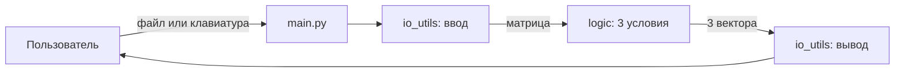

# Архитектура

## Назначение

Программа строит три логических вектора по вещественной матрице n × m (вариант 7).
Архитектура — трёхуровневая и намеренно простая: логика отделена от ввода-вывода,
чтобы её можно было тестировать без консоли и затем интегрировать с другими модулями (ЛР №3).

## Состав

| Компонент | Файл | Ответственность |
|-----------|------|-----------------|
| Логика | `src/matrix_lab/logic.py` | проверка матрицы и три условия варианта; не зависит от ввода-вывода |
| Ввод-вывод | `src/matrix_lab/io_utils.py` | разбор текста матрицы, чтение из файла и консоли, форматирование |
| Точка входа | `src/main.py` | разбор аргументов командной строки, связывание ввода, логики и вывода, коды возврата |
| Тесты | `tests/` | модульные тесты логики и разбора ввода, тест точки входа |

## Схема

## Принятые решения

- **Допуск сравнения** `EPS = 1e-9`: вещественные числа нельзя сравнивать точно
  (`0.1 + 0.2 != 0.3`).
- **Нестрогое убывание** в условии 2 (`a[j] >= a[j+1]`); строка из одного элемента упорядочена и
  симметрична.
- **Ошибки** во входных данных — исключение `ValueError`; точка входа превращает его в сообщение
  и ненулевой код возврата.
- **Без внешних зависимостей**: стандартная библиотека Python.
