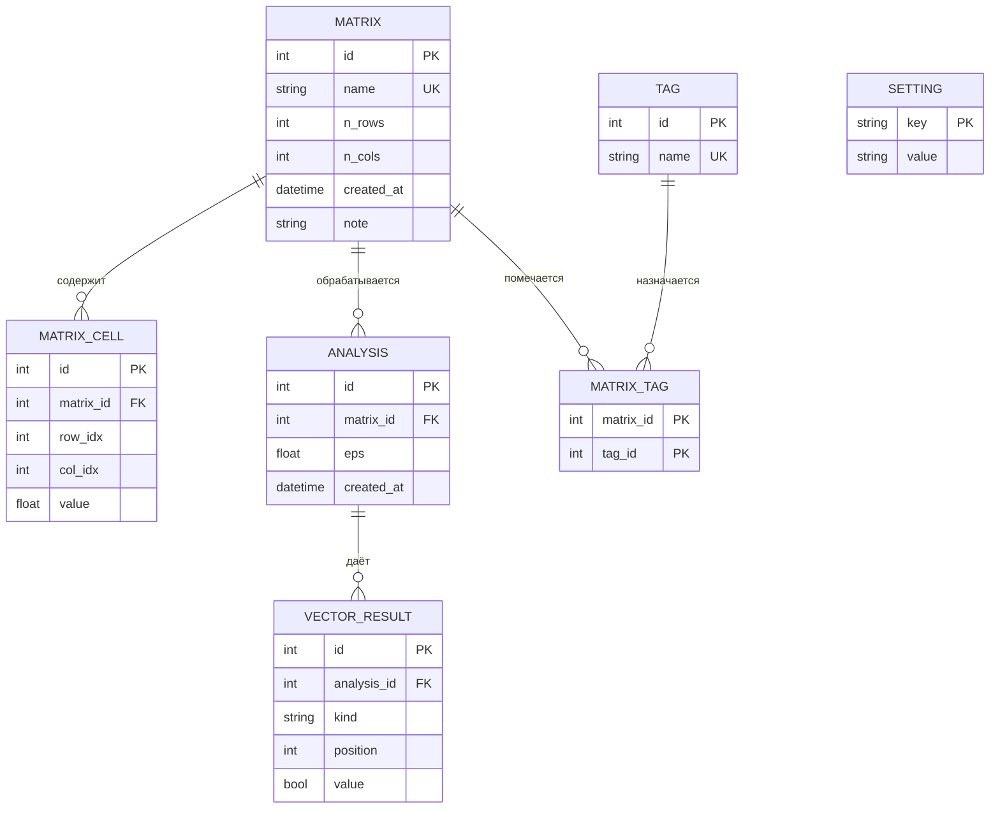

# ER-диаграмма хранилища данных

Предметная область — сквозной проект варианта 7 (логические векторы по вещественной матрице n × m).
Диаграмма отображается на GitHub автоматически (Mermaid); картинка — `docs/er_diagram.png`.

## Сущности и связи

| Сущность | Назначение | Связи |
|---|---|---|
| `matrix` | Сохранённая матрица: имя, размеры, примечание | 1:N с `matrix_cell` и `analysis`; M:N с `tag` |
| `matrix_cell` | Один элемент матрицы (строка, столбец, значение) | N:1 к `matrix` |
| `tag` | Тег для группировки и фильтрации матриц | M:N с `matrix` через `matrix_tag` |
| `matrix_tag` | Связующая таблица M:N | N:1 к `matrix` и `tag` |
| `analysis` | Запуск обработки матрицы (параметр `eps`, время) | N:1 к `matrix`; 1:N с `vector_result` |
| `vector_result` | Элемент одного из трёх логических векторов | N:1 к `analysis` |
| `setting` | Настройки пользователя (адаптация интерфейса) | не связана |
