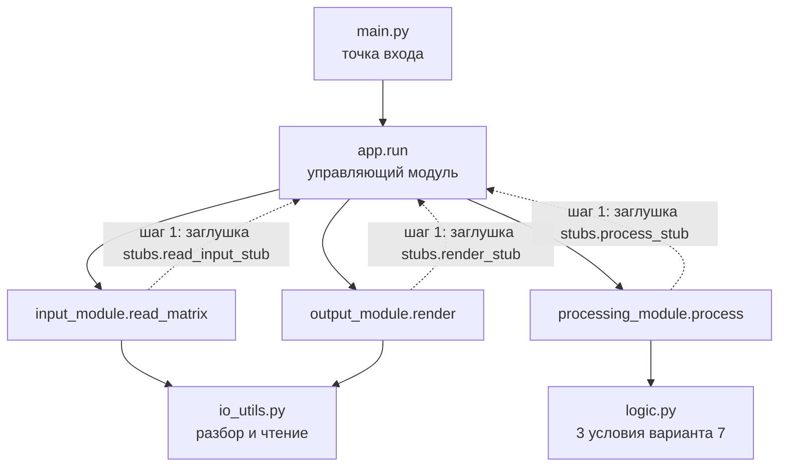

# План интеграции модулей (ЛР №3)

Проект остаётся сквозным: ТЗ (ЛР №1) → репозиторий и структура (ЛР №2) → интеграция модулей (ЛР №3).
Вариант 7 из ЛР №1 (матрицы) сохранён; из варианта 7 ЛР №3 взяты **тип интеграции — нисходящая** и
**протокол — прямой вызов функций** (для уровня 2 добавляется транспортный протокол REST).

## Состав модулей

| Модуль | Файл | Назначение | Интерфейс |
|--------|------|-----------|-----------|
| Управляющий (верхний) | `src/matrix_lab/app.py`, `src/main.py` | связывает модули в конвейер, обрабатывает ошибки, возвращает код возврата | `run(read_input, process, render) -> int` |
| Ввод | `src/matrix_lab/input_module.py` | получает матрицу из файла или с клавиатуры | `read_matrix(source) -> Matrix` |
| Обработка | `src/matrix_lab/processing_module.py` | строит три логических вектора (логика ЛР №1) | `process(matrix) -> ProcessingResult` |
| Вывод | `src/matrix_lab/output_module.py` | формирует текстовый отчёт | `render(report) -> str` |
| Общие контракты | `src/matrix_lab/models.py`, `errors.py` | структуры данных и исключения | `ProcessingResult`, `Report`, `IntegrationError` |

## Выбранная стратегия: нисходящая

Сначала готовится верхний модуль (`app`) и интерфейсы, нижние модули временно заменяются
**заглушками**, затем заглушки по очереди заменяются настоящими модулями.

**Обоснование выбора:**

- у системы есть явный «верхний» модуль-координатор, а нижние модули (ввод, обработка, вывод) — простые;
- общий конвейер и интерфейсы между модулями проверяются с самого начала, ошибки взаимодействия
  находятся рано, когда их дёшево исправлять;
- работоспособный «скелет» программы появляется на первом же шаге и показывается преподавателю;
- восходящая стратегия потребовала бы писать драйверы для проверки нижних модулей, а
  сэндвич-интеграция для трёх модулей избыточна.

## Порядок интеграции

| Шаг | Что делаем | Ветка |
|-----|-----------|-------|
| 0 | определяем интерфейсы и общие контракты | `feature/interfaces` |
| 1 | верхний модуль + заглушки всех нижних | `feature/top-module` |
| 2 | заменяем заглушку ввода настоящим модулем | `feature/input-module` |
| 3 | заменяем заглушку обработки настоящим модулем | `feature/processing-module` |
| 4 | заменяем заглушку вывода настоящим модулем | `feature/output-module` |
| 5 | (уровень 2) REST-транспорт для модуля обработки | `feature/rest-transport`, `feature/http-option` |

## Схема интеграции

## Интерфейсы между модулями

| Откуда → куда | Передаётся | Тип |
|---------------|-----------|-----|
| ввод → управляющий | матрица | `Matrix = List[List[float]]` |
| управляющий → обработка | матрица | `Matrix` |
| обработка → управляющий | три вектора | `ProcessingResult(zero_columns, descending_rows, symmetric_rows)` |
| управляющий → вывод | матрица и три вектора | `Report(matrix, zero_columns, descending_rows, symmetric_rows)` |
| любой модуль → управляющий | сбой | `IntegrationError` и подклассы (с `exit_code`) |

## Заглушки

| Заглушка | Заменяет | Поведение |
|----------|----------|-----------|
| `stubs.read_input_stub` | модуль ввода | возвращает матрицу 2 × 2 |
| `stubs.process_stub` | модуль обработки | возвращает векторы из `False` нужной длины |
| `stubs.render_stub` | модуль вывода | возвращает строку «[заглушка] вывод для матрицы NxM» |

Драйверы не требуются: нисходящая стратегия обходится заглушками.

## Обработка ошибок взаимодействия

Любой модуль сообщает о сбое исключением `IntegrationError` (подкласс `InvalidDataError` для
некорректных данных). Управляющий модуль перехватывает его, печатает сообщение в `stderr` и
возвращает `exit_code` исключения — единое место обработки ошибок.
